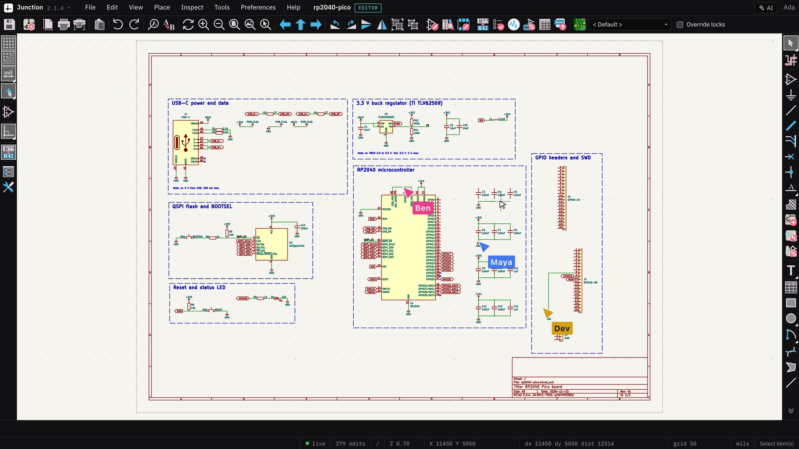
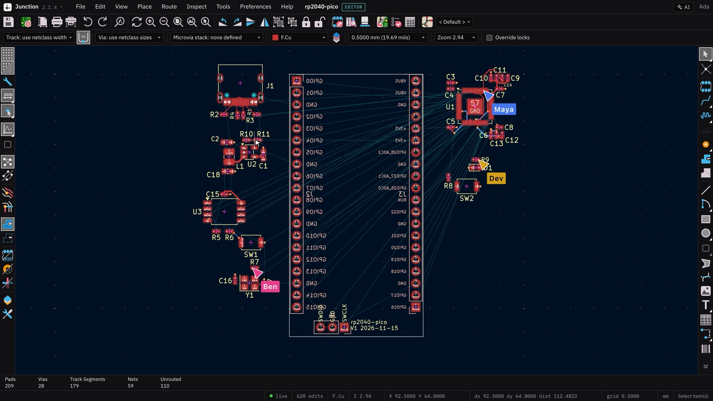
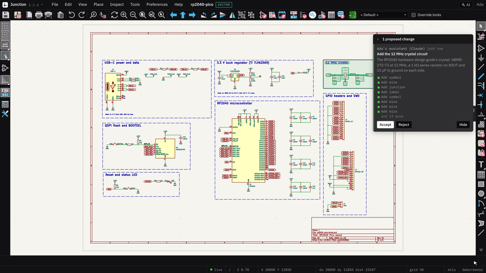
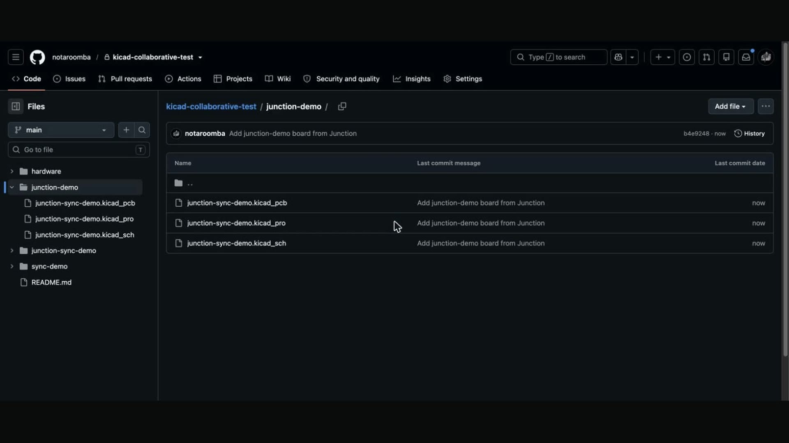
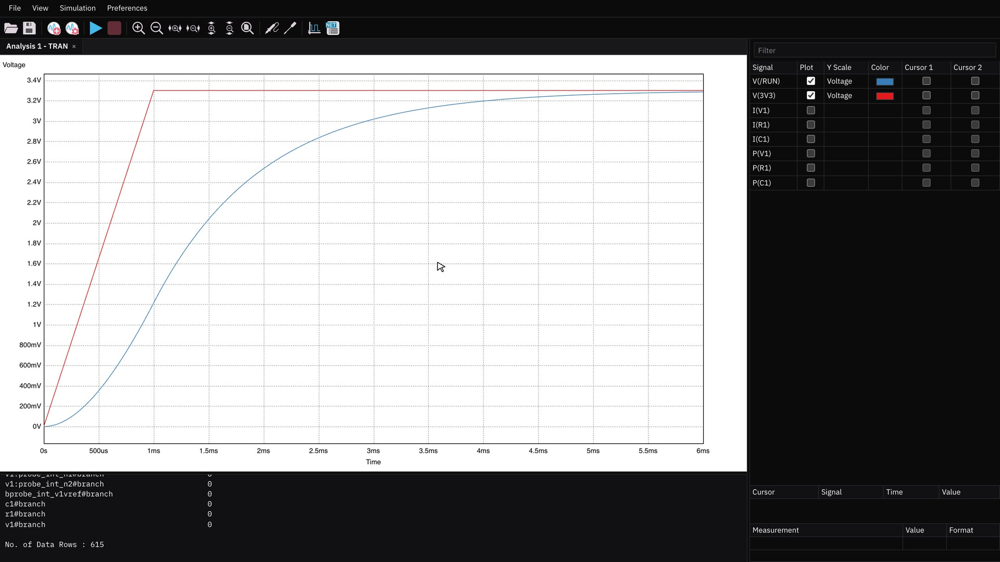
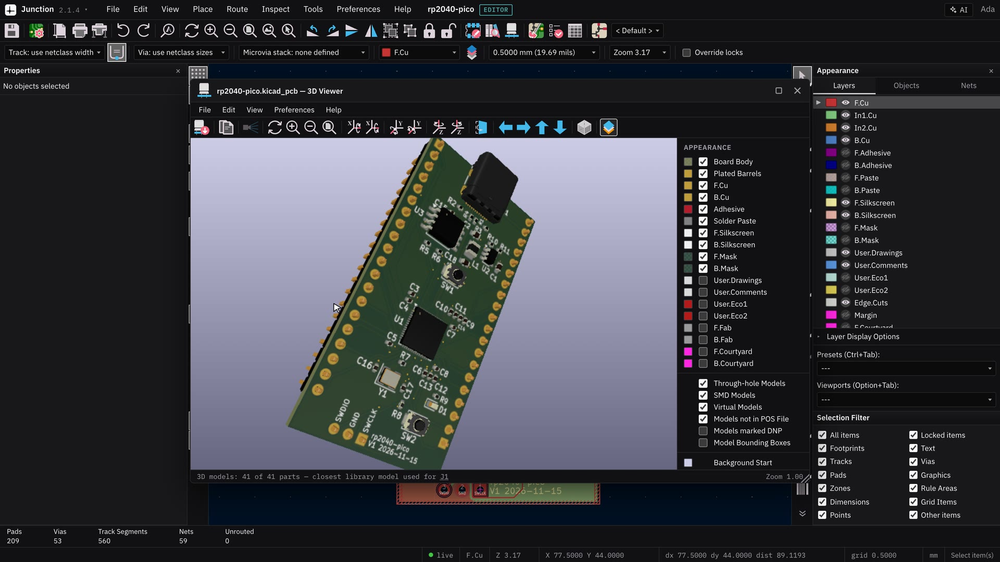

<p align="center"></p>

<h1 align="center">Junction</h1>

<p align="center"><b>Real-time collaborative KiCad.</b><br>
Schematic and PCB editors where everyone works on the same design at once, on the desktop or in the browser,<br>
with any AI model as a teammate. Open source under GPL-3.0.</p>

<p align="center">
  <a href="https://junctioneda.com"><b>Open in the browser</b></a> ·
  <a href="https://github.com/JunctionEDA/junction/releases/latest"><b>Download for macOS, Windows, Linux</b></a> ·
  <a href="#design-with-an-ai"><b>Connect an AI</b></a>
</p>

<p align="center">
  <a href="https://github.com/JunctionEDA/junction/releases/latest"></a>
  <a href="LICENSE"></a>
</p>

<!-- The demo video. GitHub plays a video inline only from a github.com/user-attachments URL: to get the inline
     player, drag docs/media/junction-demo.mp4 into this file in GitHub's editor and let the URL it inserts replace
     the poster link below. -->

https://github.com/user-attachments/assets/4089e936-c17c-4153-b253-e5f6324e9056

<p align="center"><sub>Four people build a Raspberry Pi Pico board together, from the first symbol to the filled planes. Music: Grieg, <i>In the Hall of the Mountain King</i>, Musopen (public domain).</sub></p>

## Install

| You want | Do this |
|---|---|
| The browser editor | Open [junctioneda.com](https://junctioneda.com) and sign in with GitHub. Nothing to install. |
| The desktop app | Download Junction for [macOS](https://junctioneda.com/download/macos), [Windows](https://junctioneda.com/download/windows) or [Linux](https://junctioneda.com/download/linux) (newest release; all files on the [releases page](https://github.com/JunctionEDA/junction/releases/latest)). |
| An AI app that designs with you | Add `https://junctioneda.com/mcp` as an MCP server (commands [below](#design-with-an-ai)). |
| Your own server | `cargo run` in [`server/`](server/README.md#running) with a Postgres database. |

Projects are ordinary KiCad files, and projects from any KiCad version from 6 to 10 open as they are. Everyone in a project should be on 2.0: it is built on a much newer KiCad than
1.0.9 and can write things an older client cannot read.

## Quick start

1. In the desktop app choose **File → Online Projects…**, or open the site, and sign in with GitHub.
2. Upload a KiCad project, or start a blank one.
3. **Share…** it with a GitHub username or an email address, or copy an edit, comment-only or view-only link.
4. Open the same schematic or board on both sides. Cursors and edits are live from there.

## What it does

<table>
<tr>
<td width="50%"><br><b>Live, together.</b> Everyone in the same schematic or board, each with their own view. Cursors, selections, drags in progress and edits arrive as they happen, between the desktop app and the browser alike.</td>
<td width="50%"><br><b>The whole board flow.</b> Update PCB from Schematic, placement, interactive routing, zones, DRC and the autorouter, following KiCad's own tools and dialogs.</td>
</tr>
<tr>
<td width="50%"><br><b>Any AI as a teammate.</b> An MCP server lets Claude, ChatGPT, Gemini, Cursor or a local model read and edit your projects. It points at what it means and proposes changes you accept or reject.</td>
<td width="50%"><br><b>GitHub sync.</b> Connect a project to a repository: push, pull and an item-level merge, through a GitHub App installed per repository.</td>
</tr>
<tr>
<td width="50%"><br><b>SPICE in the tab.</b> The simulator runs in the browser, on the schematic you are drawing.</td>
<td width="50%"><br><b>3D and fabrication.</b> The 3D viewer with real part models, and Gerbers, drill, placement and BOM with presets for JLCPCB and PCBWay.</td>
</tr>
</table>

And the rest of what a team needs:

- **Version history.** Every edit of the last 30 days can be scrubbed through; named versions and branches are kept
  for good, and two versions can be compared side by side.
- **Sharing and roles.** Editors, commenters and viewers, by GitHub username, email or link. View links open without
  an account.
- **Review.** Comment threads pinned to parts and nets that follow them when they move.
- **Offline.** The desktop app keeps working without a connection and merges when it returns.
- **Parts.** Search LCSC, Mouser and DigiKey and place the symbol and footprint straight into the schematic.
- **Plugins.** One catalog for built-in, KiCad and community plugins, sandboxed and permissioned.

## Design with an AI

Junction's server is an MCP endpoint. The model is your AI app's: Junction never calls one.

```sh
# Claude Code
claude mcp add --transport http junction https://junctioneda.com/mcp
```

```json
{ "mcpServers": { "junction": { "url": "https://junctioneda.com/mcp" } } }
```

claude.ai, ChatGPT, VS Code, Gemini CLI and Codex are on the site's **Connect an AI assistant** page and in
[server/README.md](server/README.md#mcp-server-any-ai-model-or-service). You sign in once and choose whether it may
make changes; the project's roles apply to it as they do to a person.

Then ask for a board. The model works through a Python harness (`run_python`): one tool call places parts by
name, wires them like the datasheet's application circuit, lays out and routes the board, and returns only what the
script prints, so a design costs few tokens. The Pico board in the video was drawn by
[two such scripts](server/scripts/demo-video/pico) before it was taken apart and put back together on camera.

## Status

Junction 2.2.1 is the current release (the name changed from KiCad Collaborative at 2.0.0). What to know:

- **It is a fork.** Collaboration is built into the editors, so you run Junction's build, not a plugin for stock
  KiCad. It follows upstream KiCad master (merged through 2026-11-17); About says "based on KiCad 10".
- **Same text field, same instant: the later value wins.** There is no merge inside one property. Undo restores
  your version of an item even if a collaborator changed it since.
- **All three desktop builds come from CI**, and each release run installs and launches them on clean machines
  before publishing. Windows and Linux have had less hands-on use than macOS.
- **The browser editor follows KiCad closely, not perfectly.** Small differences in behaviour are still being found
  and fixed.
- **AI-made boards need review.** The harness runs ERC, DRC and a design checklist, but nobody has ordered and
  powered the board in the video.
- **Vendor part search needs API keys** (Mouser, DigiKey) on a self-hosted server.

[COLLABORATION.md](COLLABORATION.md) lists what synchronizes and how conflicts resolve.

## How the demo video was made

Every shot is the real application against a local Junction server, staged by scripts in
[server/scripts/demo-video](server/scripts/demo-video):

- The Pico board was designed first by the [harness scripts](server/scripts/demo-video/pico); `prepare.mjs` then
  took every part, wire and track out of it and kept them.
- `record-junction.mjs` opens four browsers, one per person, and puts the design back one item at a time, each
  through that person's own editor with their mouse on it. Ada's window is the one filmed: the other cursors and
  their edits arriving are Junction's live sync doing its normal work.
- The AI's part is a real MCP call (highlight, then a proposal Ada accepts). The chat bubble is drawn by the video.
- `render.mjs` lays the footage on the music's bars, so each feature fills whole bars and some stretches play faster
  than they were recorded. The mouse pointer is drawn by the page, because a headless browser has none.

## Docs

[Roadmap](docs/ROADMAP.md) · [Architecture](docs/ARCHITECTURE.md) · [Collaboration guide](COLLABORATION.md) · [Server, protocol and self-hosting](server/README.md) ·
[MCP server](server/README.md#mcp-server-any-ai-model-or-service) ·
[Python harness](server/README.md#the-python-harness) · [Autorouter](server/README.md#board-autorouter) ·
[Changelog](CHANGELOG.md)

## License

[GPLv3](LICENSE), as KiCad. Junction is an independent fork and is not affiliated with or endorsed by the KiCad
project.

---

## Based on KiCad

Junction is built on [KiCad](https://kicad.org/) and stays current with it: every week
[upstream-sync](tools/upstream-sync/README.md) merges KiCad's latest changes, builds and tests them on Linux,
Windows and macOS, and only then moves `master`. For building the desktop code and its style, see KiCad's
[developer documentation](https://dev-docs.kicad.org). Problems with Junction belong in this repository's
issues, not KiCad's tracker.
